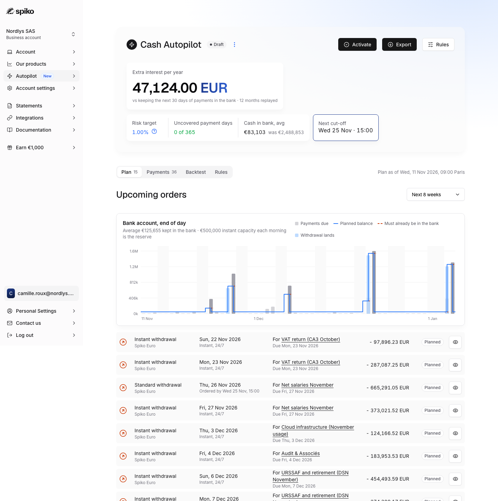

# Cash Autopilot for Spiko

**Live demo:** https://mohith26.github.io/spiko-cash-autopilot/

Spiko's Series B post (6 Oct 2026) describes where the product is going: *"Your finance team sets its rules once, for example: automatically withdraw what's needed when payroll and supplier payments fall due."* This is a working version of that rule, built inside a replica of the Spiko app. It reads a company's scheduled payments, plans every withdrawal from Spiko Euro (or Spiko T-Bills Euro) as late as the real cut-offs and fund holidays allow, keeps only what the €500,000/day instant withdrawal cannot bring in time, and sizes the safety margin from the company's own forecast errors so the user picks a risk target instead of guessing a buffer. On a 12-month replay of a synthetic 150-person French SaaS company it earned **€47,124 more interest a year** than keeping the next 30 days of payments in the bank (average bank balance €83,103 instead of €2,488,853) with **0 uncovered payment days**, while the literal "withdraw on the due date" rule left 24 payment days short because of the instant cap.



## What you can do in the demo
- **Plan** (`#/autopilot`): upcoming standard and instant withdrawals with their submit-by times, the payment each one exists for, and a chart of the planned bank balance against the cash that must already be in the account.
- **Day breakdown** (`#/autopilot/day/2026-11-27`): payments due, how the calibrated need is computed (forecast, scale, conformal multiplier, number of past days), where the morning cash comes from, and a week calendar with Spiko's real non-operating days. Arrow keys move between payment days.
- **Payments** (`#/autopilot/payments`): edit a date or amount, add or remove a payment; the plan re-optimises instantly and flags payments that cannot be covered anymore.
- **Backtest** (`#/autopilot/backtest`): four policies on the same 365 days, the realized miss rate for each risk target, and fixed buffers versus calibrated margins.
- **Rules** (`#/autopilot/settings`): source fund, risk target, minimum balance. Activate/pause with a confirmation dialog (state persists in localStorage). Export the plan as CSV or as Spiko Investor API request bodies (`POST /v1/withdrawal-orders/`). Shortcuts: `1-4` tabs, `e` export, `a` activate, `?` help.

## How it works
1. **Calendar and lead times** (`core/calendar.js`). Spiko Euro: ordered before 15:00 Paris, processed the next business day; T-Bills Euro: before 11:30, same day; SEPA credit on TARGET2 days; instant withdrawals 24/7 up to €500,000 a day (support.spiko.io). Fund non-operating days come from Spiko's public API (`/v0/funds/`), so e.g. 11 November 2026 is closed for T-Bills Euro but open for Spiko Euro. TARGET2 holidays are computed (Easter algorithm) and tested against the API list.
2. **Forecast** (`core/forecast.js`). For each day: scheduled payments at their latest estimate (recurring ones such as payroll, URSSAF/DSN, VAT and cloud are projected about 80 days ahead with a wide spread, then tightened as payroll files and returns are final; supplier invoices once received) plus expected card spend; a scale σ from each estimate's stated precision and the spread of card spend. Receipts are never counted until they arrive.
3. **Calibrated need** (`core/conformal.js`). Split-conformal upper bound U = f + q·σ, with q the ⌈(n+1)(1-α)⌉-th smallest normalized error of the last 36 months, kept separately (Mondrian) for payment-heavy vs ordinary days and for 0-4+ days ahead. With fewer than 1/α - 1 scores it falls back to Chebyshev (1/√α).
4. **Optimal plan** (`core/plan.js`). Requirements: expected payments are paid from morning cash; at the end of each day the bank holds the minimum balance plus max(0, U(tomorrow) − tomorrow's instant capacity); standard withdrawals land only on settle days reachable before their cut-off. Idle cash is a sum of cumulative moves, so a single backward pass gives the smallest feasible value at every slot and a forward pass repairs instant withdrawals to be non-negative: the plan is optimal in O(days). Tests check it against an independent simplex LP on 400 random instances.
5. **Backtest** (`core/backtest.js`). The policy re-plans every morning at 09:00 using only what was known then, submits standard withdrawals on their last possible day, tops up with instant withdrawals in real time, sweeps surplus back at night. Idle cash is valued at Spiko T-Bills Euro's published NAV returns.

## Results (12 months, 11 Nov 2025 to 10 Nov 2026, Spiko Euro cut-offs)
| Policy | Bank balance, avg | Interest given up | Uncovered days | Standard orders |
|---|---|---|---|---|
| Cash Autopilot, 1% risk target | €83,103 | €1,609 | 0 | 19 |
| Same planner, no calibrated margin | €77,662 | €1,506 | 0 | 19 |
| Keep the next 30 days of payments in the bank | €2,488,853 | €48,733 | 0 | 187 |
| Withdraw on the due date (instant only) | €48,494 | €953 | 24 (€7,512,582 of payments) | 0 |

Does the risk target hold? Share of days whose outflow beat the calibrated need, 1 to 3 days ahead:

| Target | Payment-heavy days | Other days |
|---|---|---|
| 1% | 0.0% (0/138) | 0.9% (9/957) |
| 2% | 2.2% (3/138) | 1.6% (15/957) |
| 5% | 7.2% (10/138) | 4.1% (39/957) |
| 10% | 15.9% (22/138) | 11.7% (112/957) |

Fixed buffer vs calibrated margin (same planner):

| Protection | Bank balance, avg | Uncovered days |
|---|---|---|
| Minimum balance €0, no margin | €27,674 | 10 |
| Minimum balance €10,000, no margin | €37,662 | 0 |
| Minimum balance €25,000, no margin | €52,662 | 0 |
| Minimum balance €50,000, no margin | €77,662 | 0 |
| Calibrated margin, 1% target, no minimum | €33,103 | 0 |
| Calibrated margin, 2% target, no minimum | €30,502 | 0 |
| Calibrated margin, 5% target, no minimum | €28,530 | 2 |

All numbers are produced by `node scripts/seed.mjs` and re-checked by `test/core.test.js` (the headline test recomputes the backtest from the seed).

## Honest limitations
- **Synthetic company.** Payment calendars follow published French rules (DSN on the 5th for 50+ employees, monthly CA3 VAT, payroll on the 28th) but amounts are seeded, not real. Fund calendars, cut-offs, NAVs and yields are real public Spiko data (fetched 2026-11-10).
- **Exchangeability.** Conformal guarantees assume errors look like past errors. At a 10% target the payment-heavy miss rate ran at 15.9% because payroll grows about 1% a month; the demo only offers 1-5%. An online correction (adaptive conformal inference) is the natural next step.
- **Per-day, not per-plan, guarantee.** The bound is calibrated per payment day; multi-day joint coverage is not claimed.
- **Simplifications.** Payments leave in the morning and standard withdrawals land in the afternoon; interest is valued on calendar days without modelling the exact accrual on the withdrawal day; the €500k instant limit is treated as shared across Spiko Euro and T-Bills Euro; four-eyes approvals are shown but not simulated.
- **The fixed-buffer comparison is close.** A €10,000 minimum balance also had 0 uncovered days here; the calibrated margin was cheaper (€33,103 vs €37,662 average) and, more importantly, does not need the buffer size guessed in advance.

## Prior art and what is new
- Classical cash-management models (Baumol 1952; Miller and Orr 1966) set control limits on a single cash balance with random flows. They do not model cut-offs, holiday calendars, a capped 24/7 instant channel or known scheduled payments.
- Products: Mercury Treasury and Rho offer maintain-a-minimum/maximum balance rules; Rho's help center notes a transfer started the day before payroll "may not arrive in time". Ramp Treasury times vendor payments to due dates. These are fixed-threshold or bill-timed rules; none publishes a risk target or an optimal cut-off-aware schedule.
- Spiko announced payment-triggered rules as an upcoming capability (Series B post, 6 Oct 2026); its docs and help center (checked 11 Nov 2026) document manual standard and instant withdrawals and the Investor API but no automatic rules.
- What this adds: an exact O(days) planner for the cut-off/instant-cap structure, distribution-free margins calibrated per day class and horizon, and an honest replay. I did not find a product or paper applying conformal bounds to withdrawal scheduling, but the search was not exhaustive.

## Run it
```
node scripts/fetch_public.mjs   # optional: refresh Spiko public data (no auth)
node scripts/seed.mjs           # regenerate data/snapshot.json and data/backtest.json
npm test                        # 15 tests: optimality vs LP, constraints, calendars, conformal coverage, headline
python3 -m http.server          # then open http://localhost:8000/
```
No build step, no dependencies: plain ES modules, Inter + Geist from Google Fonts, Lucide icons from unpkg.

Unofficial concept demo by Mohith Gajjela. Not affiliated with Spiko. Synthetic company data; fund calendars, NAVs, yields and cut-off times from Spiko's public API and help center. Design tokens from Spiko's public design-system repository.
